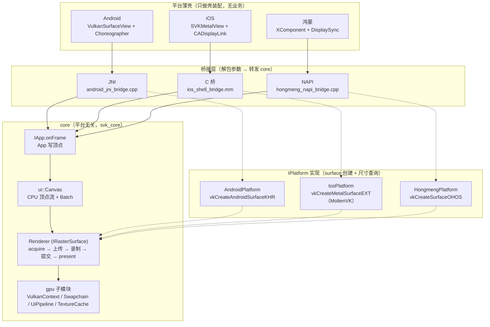
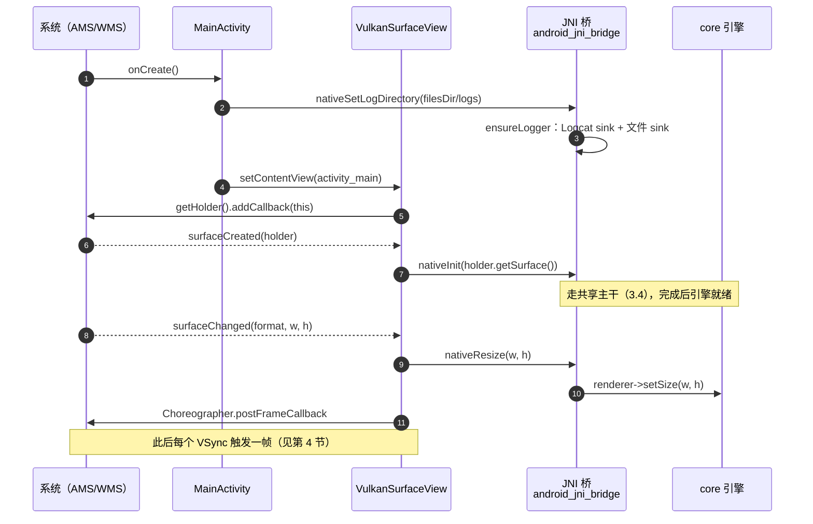
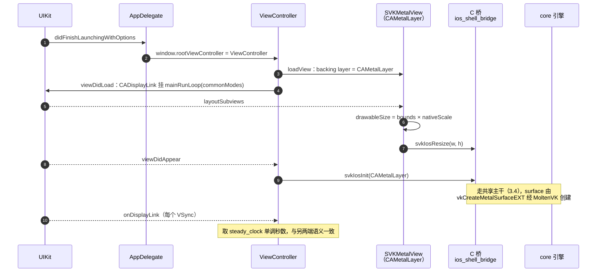
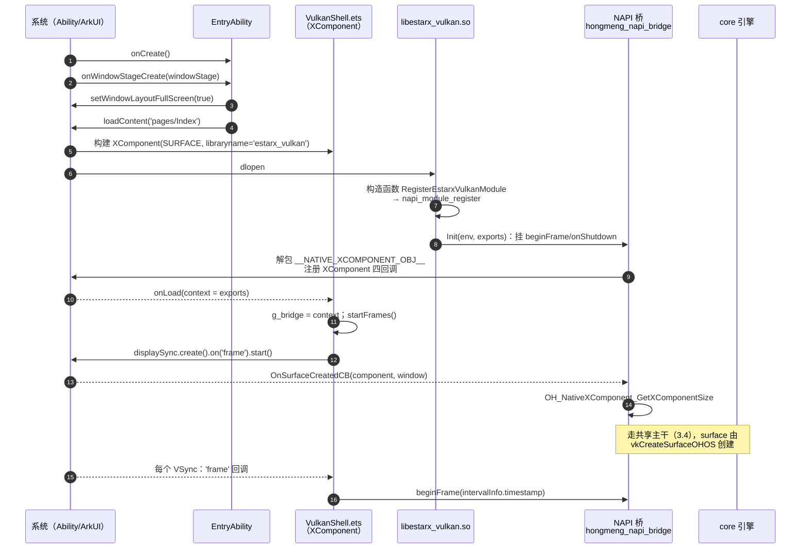
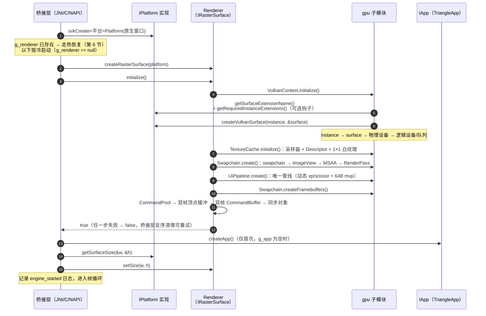
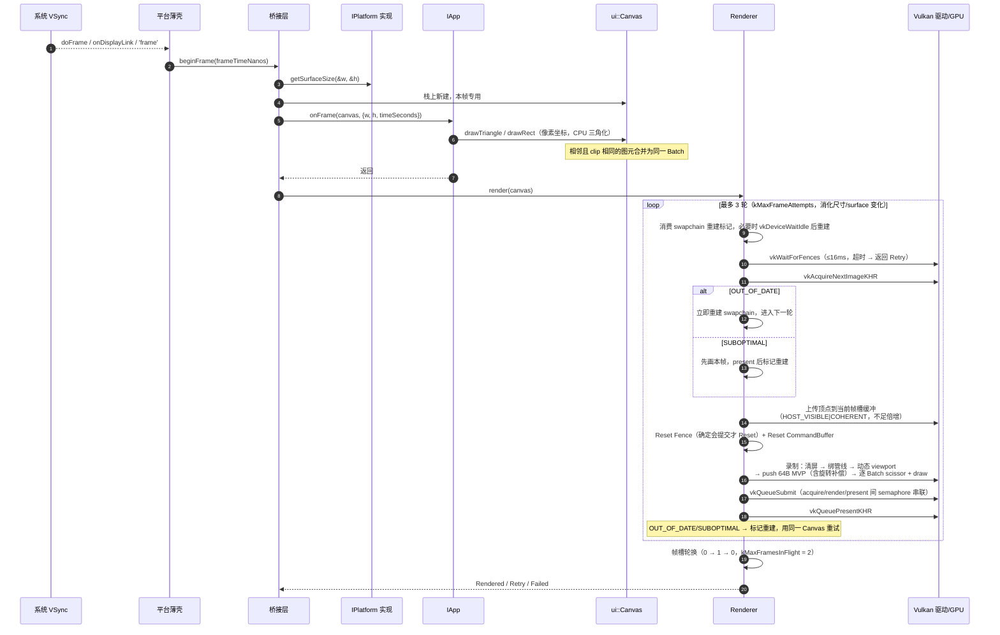
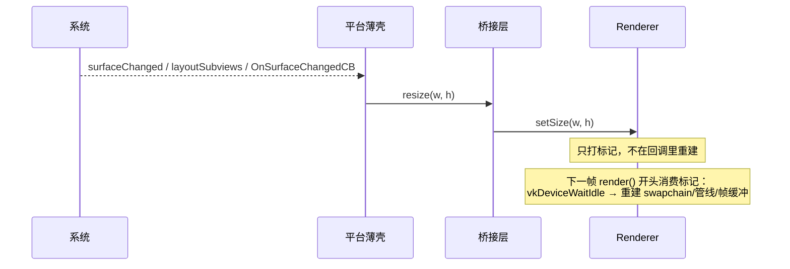
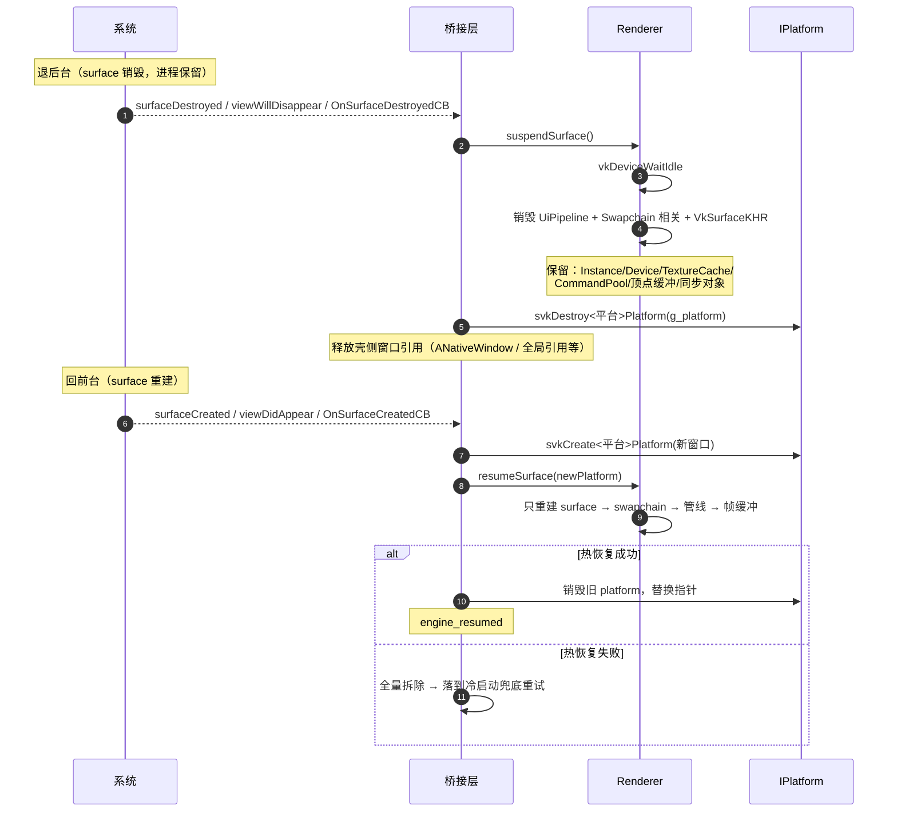

# 启动与帧渲染时序（三端对照）

本文用时序图说明这套种子工程"从进程启动到三角形的每一帧上屏"的完整链路，
配合 [engine-core.md](engine-core.md)（引擎内部实现清单）和
[project-structure.md](project-structure.md)（目录与工程组织）阅读。

设计前提回顾：

- 依赖方向 **App → core ← platform**，三端桥接层刻意同构。
- 全部壳回调与引擎调用都在 **UI 线程** 顺序执行，引擎内部无锁。
- 生命周期只有两种语义：**保活挂起/热恢复**（surface 级资源）
  和 **真正销毁**（全量释放）。

## 1. 运行时总览

## 2. 三端入口接线对照表

| 环节 | Android | iOS | 鸿蒙 |
|---|---|---|---|
| 进程入口 | `MainActivity.onCreate` | `main.m → UIApplicationMain` | `EntryAbility.onCreate` |
| 日志目录注入 | `nativeSetLogDirectory(filesDir/logs)` | `svkIosInit` 内自取 `Application Support/logs` | `OH_AbilityRuntime_ApplicationContextGetFilesDir()` |
| surface 载体 | `SurfaceView`（SurfaceHolder.Callback） | `CAMetalLayer`（SVKMetalView 的 backing layer） | `XComponent(SURFACE)` 的 `OHNativeWindow` |
| 引擎启动触发 | `surfaceCreated` → `nativeInit` | `viewDidAppear` → `svkIosInit` | `OnSurfaceCreatedCB`（XComponent 回调） |
| VSync 通道 | `Choreographer.postFrameCallback` | `CADisplayLink`（common runloop modes） | ArkTS `displaySync.on('frame')` |
| 帧回调入口 | `nativeBeginFrame(frameTimeNanos)` | `svkIosBeginFrame(nanos)`（steady_clock） | `beginFrame(intervalInfo.timestamp)` |
| 尺寸变化 | `surfaceChanged` → `nativeResize` | `layoutSubviews` → `svkIosResize` | `OnSurfaceChangedCB` |
| 保活挂起 | `surfaceDestroyed` → `nativeDestroy` | `viewWillDisappear` → `svkIosSuspend` | `OnSurfaceDestroyedCB` |
| 真正销毁 | `Activity.onDestroy` → `nativeShutdown` | `ViewController.dealloc` → `svkIosShutdown` | `EntryAbility.onDestroy` → `onShutdown()` |
| native 库加载 | `System.loadLibrary("estarx_vulkan")` | 静态链接进 App 二进制 | `dlopen` 后构造函数自动 `napi_module_register` |

## 3. 冷启动时序

三端差异只在"壳怎么把 surface 和 VSync 接进来"；一旦进入桥接层，
后续走的是同一条共享主干（见 3.4）。

### 3.1 Android

### 3.2 iOS

### 3.3 鸿蒙

注：鸿蒙刻意用 ArkTS `DisplaySync` 而非 `OH_NativeVSync`——后者回调在
独立 vsync 线程，会破坏 core 的无锁单线程假设。模块句柄刻意经
`onLoad(context)` 获取而不手动 `import`：手动 import 会让模块先于
XComponent 加载，`Init` 就解包不到 XComponent 实例对象。

### 3.4 共享主干：桥接层 → 引擎（三端一致）

## 4. 每帧渲染时序（VSync → 上屏）

关键点：

- **双帧在飞**：命令缓冲、Fence、顶点缓冲都是双份，CPU 最多领先 GPU 一帧，
  上传顶点不会覆盖 GPU 正在读的上一份。
- **重试语义**：`Retry` 表示"稍后再来"（等待超时/图像暂不可用/重建重试耗尽），
  壳层不做特殊处理——下一个 VSync 自然重试。空 Canvas 也会形成清屏帧。
- **旋转补偿**：App 永远用左上角原点、Y 轴向下的像素坐标；Renderer 根据
  swapchain 的 `currentTransform` 在 MVP 和 scissor 上补偿 90/180/270°。

## 5. 尺寸变化（旋转/分屏/窗口化）

## 6. 保活挂起与热恢复（退后台 → 回前台）

挂起与恢复的真正销毁对照：Activity.onDestroy / ViewController.dealloc /
EntryAbility.onDestroy → `nativeShutdown` / `svkIosShutdown` / `onShutdown`，
做全量释放（app.reset → delete renderer → destroy platform），之后再次启动
走完整冷启动。

## 7. 涉及文件索引

| 环节 | 文件 |
|---|---|
| 公共接口 | `core/src/app.h`、`core/src/render_platform.h`、`core/src/raster_surface.h` |
| 引擎 | `core/src/vulkan_renderer.*`、`core/src/gpu/*`、`core/src/ui/canvas.*` |
| Android | `platform/android/java/.../VulkanSurfaceView.java`、`NativeBridge.java`、`platform/android/cpp/android_jni_bridge.cpp`、`android_vulkan_platform.cpp` |
| iOS | `samples/triangle/ios/SVKApp/ViewController.mm`、`platform/ios/ios_shell_bridge.mm`、`ios_vulkan_platform.mm` |
| 鸿蒙 | `samples/triangle/hongmeng/entry/src/main/ets/vulkan/VulkanShell.ets`、`entryability/EntryAbility.ets`、`platform/hongmeng/cpp/hongmeng_napi_bridge.cpp`、`hongmeng_vulkan_platform.cpp` |
| App 示例 | `samples/triangle/app.cpp`、`samples/triangle/triangle.h` |
